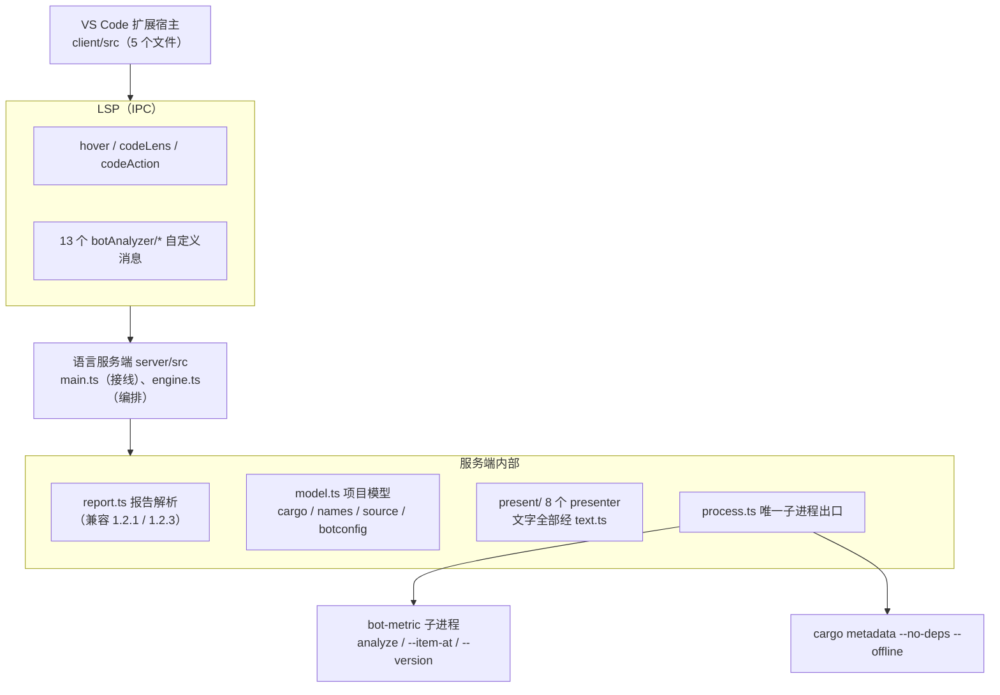
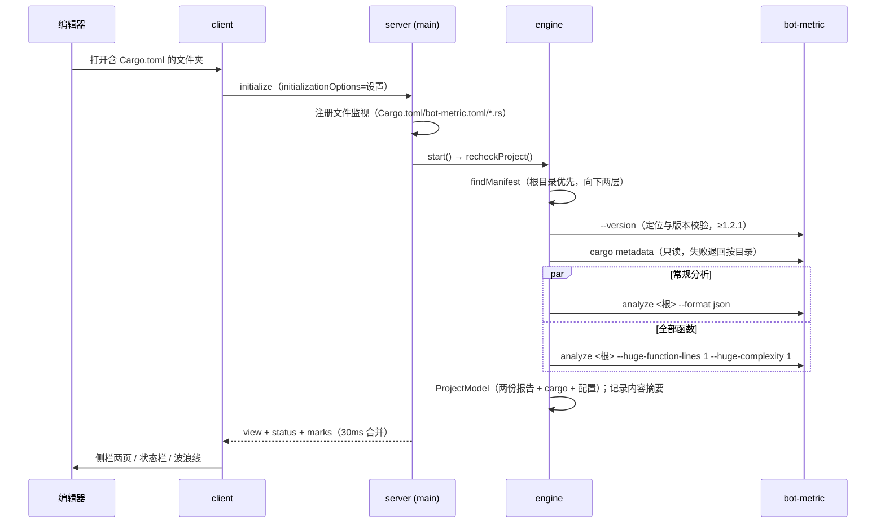

# Bot Analyzer 架构设计（0.1.0）

## 1 文档目的与范围

本文定扩展的结构：进程与模块划分、检测编排、数据流、与 bot-metric / cargo 的接入方式。界面上有什么、怎么用，由使用手册（`docs/manual/`，10 章）规定；必须做到什么、怎么验收，由需求规格说明规定。本文只引用结论。

| 文档 | 回答的问题 |
| --- | --- |
| 《bot-analyzer 需求规格说明 0.1.0》 | 必须做到什么，怎么判定做到了（FR / NFR 编号） |
| `docs/manual/` 使用手册 | 界面长什么样、怎么用（以它为用户面权威） |
| 本文 | 怎么搭：进程、模块、检测编排、协议、契约 |
| `bot-metric/schema/analysis-report-*.json` | 报告契约的字段定义 |

范围内：VS Code 扩展客户端与 LSP 服务端的内部结构、bot-metric 与 cargo 的接入方式、两端协议。范围外：bot-metric 自身实现、CI 流水线、市场发布流程。

## 2 架构驱动因素

| 编号 | 驱动因素 | 当前结构的吸收方式 |
| --- | --- | --- |
| ASR-1 | 编辑器数值必须与同版本 bot-metric + 同一份 `bot-metric.toml` 的命令行一致（需求 NFR-4） | 扩展不计算任何度量：阈值、质量目标、门禁、范围全部来自报告；「全部函数」等派生数据注明口径 |
| ASR-2 | 保存要快，大项目不能拖慢编辑（FR-4、FR-5） | 保存先做单文件检测（约 0.1 秒级），项目检测 2 秒防抖后台做；超过耗时门槛就不自动做（「待更新」）；子进程超时 / 取消 / 输出超限统一终止进程树 |
| ASR-3 | 失败与不完整必须可见、不丢已有结果（FR-20） | 引擎状态机 `phase` + `Failure` + 单文件 `FileCheck`；失败保留旧模型，界面写明原因与时间 |
| ASR-4 | 与 rust-analyzer 共存（NFR-3） | 不发 LSP 诊断集合（决策 D3），问题以装饰波浪线呈现；CodeLens 只挂超限项；cargo 只用 `metadata --no-deps --offline` |
| ASR-5 | bot-metric 报告契约会演进（1.2.1 → 1.2.3 已有字段差异） | 契约差异集中在一个解析文件 `report.ts`，模型层不感知版本 |
| ASR-6 | 界面文字要保持中文与统一格式（NFR-9） | 所有用户可见文字与数字格式集中在服务端 `text.ts`，客户端不拼文案、不认识工具 |

## 3 关键技术决策

### DR-1 双进程：TypeScript/Node 的 LSP 客户端 + 服务端

扩展客户端（`client/src/extension.ts`）用 `vscode-languageclient` 经 IPC 启动服务端 `out/server/src/main.js`（`vscode-languageserver`）。两端同为 TypeScript、CommonJS（`tsconfig.json`：ES2022 / commonjs / strict，产物 `out/`），共用 `shared/protocol.ts` 一份类型与消息名。bot-metric 不提供库 API（CLI + JSON 报告是其机器接口），子进程接入由服务端统一承担。

### DR-2 服务端把要显示的文字全部算好，客户端只画

`shared/protocol.ts` 文件头即为契约：服务端把中文、术语括号、上限写法、颜色分类（`Cell.cls`：o 橙超出、n 黄接近、m 灰）全部算进 `ViewModel` / `StatusModel` / `RulePanelModel` 等负载；客户端不出现任何工具名、规则编号或度量文案（`layout.test.ts` 断言 `client/` 里没有 `bot-metric`、`cargo`、`BM00x` 字样）。好处：文案与格式单点维护（`text.ts`）、界面三处（侧栏 / 状态栏 / 导出报告）天然一致（共用 `present/summary.ts`）。

### D3 不发编辑器诊断，问题以装饰呈现

服务端 LSP capabilities 只有 hover、codeLens、codeAction；不发 `publishDiagnostics`。函数超限、unsafe、文件过大的标记由服务端经 `marks` 通知下发（span + kind + codes），客户端 `marks.ts` 画橙色波浪线（wavy 下划线）与重复代码块竖线。这样不占用「问题」面板的语义、不与 rust-analyzer 的诊断集合竞争；CodeLens 与快速修复仍走标准 LSP。

### DR-4 子进程只有一个出口，进程树必被终止

全插件只有 `server/src/process.ts` 起子进程（`layout.test.ts` 守着这一条），`run(binary, args, {cwd, timeoutMs, signal, maxStdoutBytes})` 返回 `{code, stdout, stderr, elapsedMs, notFound, timedOut, cancelled, outputLimitExceeded}`，不抛异常。stdout 上限 128 MiB（可覆盖）、stderr 截断 64 KiB；超时 / 取消 / 超限统一终止**整棵进程树**（Windows `taskkill /T /F`；非 Windows `detached` + 进程组 SIGTERM→SIGKILL）并等待 close 后返回。调用方的超时：bot-metric 分析 5 分钟、cargo metadata 30 秒、`--version` 15 秒。cargo 调用（`cargo.ts`）与版本探测（`locate.ts`）都经它。

### DR-5 报告契约差异收敛在解析层一个文件

`report.ts` 的 `parseReport()` 把 JSON 归一成内部 `Report`，兼容 `analysis-report-1.2.1` 与 `1.2.3`：

| 差异点 | 1.2.1 | 1.2.3 | 归一 |
| --- | --- | --- | --- |
| `location_kind` | 无 | file / analysis / view / none | 无时按规则编号推断（BM003/BM007→file、BM005→analysis、其余 source） |
| 函数级位置 | 只有函数名一行 | 完整范围 | `Finding` 存起止行列；模型 `hasRange` 区分，BM002 归属函数时无范围退回按名字 |
| `rules[]` 对照、`rule_set.enabled_rules` | 无 | 有 | 内置 rule_id→编号对照兜底；enabledCodes 空时模型回退 BM001–BM004 |
| `selection`（--item-at） | 无 | 有 | 代码项检测自然要求 1.2.3 行为（1.2.1 时该项功能退化为不可用） |

读前校验身份（`tool === 'bot-metric'`），不是则报「输出不是 bot-metric 的分析报告」。阈值不另配：从 metrics 的 `algorithm` 字符串里解析（如 `threshold=50`），重复行数从 `strictly_greater_than=` 解析。规则命中里的数值从 evidence / message 正则抽取（BM001 `/(\d+) body/` 等），抽不到只是少个数字不会错。`config_hash` 用于两次结果的可比性判断。

### DR-6 检测编排在引擎一个类里，状态机只有五个相位

`engine.ts` 是唯一的编排者（防抖、取消、缓存、补检都在这里），`EngineState.phase ∈ {noProject, noBinary, loading, ready, failed}`。不做多项目模型、不做全局限流：一个工作区文件夹、一个 Cargo 项目（`findManifest` 根目录优先，否则向下两层）。取数分三种，全部封装成一个 `analyze(target, extra, signal, tests)`：

| 检测 | 命令行形态 | 触发 |
| --- | --- | --- |
| 整个项目 | `analyze <项目根> --format json` + 并行一次 `analyze <项目根> --huge-function-lines 1 --huge-complexity 1 --format json`（把上限降为 1，一次拿到**全部函数**的 NLOC/CCN/范围） | 打开项目；保存防抖后；配置 / 大量文件变化 |
| 单文件 | `analyze <文件> --format json` ×2（常规 + 全部函数）+ 可选一次反口径取数（数测试函数） | 保存 `.rs`；首次切到某文件 |
| 代码项 | `--item-at <相对路径>:<行>[:<列>] [--item-relation direct-impls] --format json`（**不带 analyze 子命令**） | 悬停 impl / 类型；右键检测 |

关键机制：

- **内容摘要（sha256）**：项目检测成功后记录参与文件当时的摘要；保存后内容没变就不重跑 bot-metric、不把项目结果标过期。只记 mtime 早于检测开始的文件（检测期间改过的文件记下来会误判「没变」）。
- **防抖与取消**：保存后 `PROJECT_DELAY_MS = 2000` 内没有再保存才后台检测项目；新一轮项目检测 abort 上一轮；文件检测按代数（fileGen）作废过期结果；项目检测进行中保存的文件记入 `savedDuringRun`，结束后逐个补检。
- **「待更新」**：上次项目用时 > `projectAfterSave` 秒（缺省 3，0=从不）时保存后不自动检测，`model.staleSinceRun` 非空即界面「待更新」，状态栏点击变重检。
- **失败保留旧数**：项目失败时 `failure={at, message, configFile?}`（BM401 给出 `bot-metric.toml` 路径），有旧模型则 phase 仍 `ready`；单文件失败（BM201 等）在 `fileChecks` 记 error，保留该文件旧结果。
- **--item-at 缓存**：键 `file|line|col|relation|mtime`，上限 64；失败（reason 'failed'）不缓存，改好配置可重试。
- **可执行文件定位**（`locate.ts`）：用户设置 → 随包 `bin/` → PATH → `~/.cargo/bin`，每个候选跑 `--version` 验证且 ≥ 1.2.1；设置路径不可用直接报错不续查；工作区设置里的路径不认（防执行仓库指定程序）。

### DR-7 项目模型是不可变事实 + 可替换单文件

`model.ts` 的 `ProjectModel` 持有一次项目级取数的全部事实（两份报告、cargo 工程、配置、全部函数、问题按文件分组），展示层只读它、不再起子进程。保存后 `replaceFile()` 用单文件结果**替换**这个文件的函数与问题，只有 BM006 / BM007（跨文件才准的重复问题）保留项目级旧值。「与 hh:mm 相比」的差异（`diffSinceRun`）只在两次口径相同（`config_hash` 一致且含测试一致）时计算。

### DR-8 单一 Webview 侧栏，消息驱动整页刷新

侧栏是活动栏容器下一个 Webview 视图（`botAnalyzer.view`），两个页签（当前文件 / 整个项目）由同一前端脚本 `media/view.js` 按 `ViewModel` 渲染；规则说明是唯一另一个 Webview 面板。服务端状态变化 30 ms 合并推送（`view` + `status` + 每个打开文件的 `marks`）；客户端把页签切换、光标所在函数、待展开分节作为随行状态回传，视图未就绪时挂起（pending）待下一次模型一并下发。CSP：`default-src 'none'; style-src ${cspSource} 'unsafe-inline'; font-src ${cspSource}; script-src 'nonce-…'`。

### DR-9 两端协议：13 个自定义消息 + 标准 LSP

`shared/protocol.ts` 的 `Method`（前缀 `botAnalyzer/`）：

| 方向 | 消息 | 内容 |
| --- | --- | --- |
| 服务端 → 客户端 | `view` / `status` / `marks` | 侧栏两页模型、状态栏两项、单文件标记 |
| 客户端 → 服务端（通知） | `activeFile` / `dirty` / `recheck` / `settings` | 活动文件、有无未保存改动、手动重检、设置变化 |
| 客户端 → 服务端（请求） | `testsState` / `rulePanel` / `configPath` / `problems` / `export` / `checkAt` | 切换单测前现状、规则面板、配置路径、问题选择框、导出内容、右键检测 |

标准 LSP 侧只用：hover、codeLens、codeAction（QuickFix）、文档同步（增量 + save）、`DidChangeWatchedFiles` 动态注册（`**/Cargo.toml`、`**/bot-metric.toml`、`**/*.rs`，由服务端声明、客户端不必知道文件名）、CodeLensRefresh。右键「检测光标所在的代码项」的结果不做新消息：服务端把结果 pin 60 秒，由那个位置的**下一次悬停**给出。

### DR-10 源码粗扫只做定位，不做度量

`items.ts` 自己做一遍 Rust 记号化（跳过注释、字符串、字符字面量，识别 r#raw 标识符），只为得到函数 / impl / 类型 / trait 的**行范围**：右键菜单判断光标在什么里、「在视图中显示」展开对应分组、波浪线画在函数名上。宏不展开（宏生成的语法项看不到）。`names.ts` 把 bot-metric 的语法项名拆成 crate / 模块 / 类型 / 函数（trait 实现识别 `Trait for Type`，内联模块拆到最前）。这些只影响定位与分组，不影响任何数值。

### DR-11 bot-metric.toml 只读三个字段，其余全交给工具

`botconfig.ts` 用 `smol-toml` 只读 `[rules] duplication_findings`、`[thresholds] duplication_max_findings`、`[analysis] include_tests`（决定侧栏展示与「单元测试」开关是否锁定）；不校验其余字段——写错由 bot-metric 报 BM401，扩展把 BM401 翻成中文并给「打开 bot-metric.toml」入口。扩展从不写仓库文件。

## 4 进程与模块结构

| 部分 | 目录 / 文件 | 职责 | 不允许出现 |
| --- | --- | --- | --- |
| 客户端 | `client/src/`（extension、sidebar、status、marks、rules） | 起服务端、侧栏与规则面板两个 Webview、状态栏两项、波浪线 / 竖线装饰、24 个命令 | 任何工具名、规则编号、度量文案、拼中文界面文字 |
| 共享 | `shared/protocol.ts` | 两端消息名与负载类型 | — |
| 服务端入口 | `server/src/main.ts` | LSP 接线：悬停 / CodeLens / 快速修复 / 文档同步 / 文件监视 / 13 个消息、30 ms 合并推送 | 检测编排逻辑 |
| 编排 | `server/src/engine.ts` | 检测时机状态机、防抖、取消、缓存、补检、失败保留旧数 | LSP 类型、展示文字 |
| 契约 | `server/src/report.ts` | JSON → `Report` 归一（1.2.1 / 1.2.3） | 展示文字 |
| 模型 | `server/src/model.ts` + `cargo.ts` / `names.ts` / `source.ts` / `botconfig.ts` / `paths.ts` | 项目事实、模块归属、单文件替换、问题差异、路径规范化 | 子进程 |
| 展示 | `server/src/present/`（state、summary、sidebar、status、editor、rules、picks、export）+ `text.ts` | 把状态与模型算成 ViewModel / StatusModel / 悬停 Markdown / CodeLens / 快速修复 / 规则面板 / 选择框 / 导出 Markdown | 子进程、LSP |
| 子进程 | `server/src/process.ts` | 唯一起进程处：超时 / 取消 / 输出超限、进程树终止 | 业务逻辑 |

依赖方向：`main → {engine, present/*}`；`engine → {locate, cargo, process, report, model}`；`present/* → {model, summary, text}`（editor 还用 `items` / `names`）；`model → {cargo, names, report, source, botconfig}`。`present/` 与 `engine` 不互相 import（只共享 `state.ts` 类型与 engine 导出的语法项种类常量）。

## 5 核心数据流

### 5.1 打开项目

### 5.2 保存一个 `.rs`

保存（`save` 模式）→ 服务端 `recheckFile(file, afterSave=true)`：

1. 项目检测进行中 → 记入 `savedDuringRun`，等检测完补；
2. 内容摘要没变 → 不跑、不标过期；
3. 否则并行三次单文件调用（常规 / 全部函数 / 反口径数测试函数），`model.replaceFile()` 替换该文件的函数与问题（BM006/007 保留项目级），推送（侧栏与状态栏立即反映）；
4. 2 秒内没有再保存且上次项目用时 ≤ `projectAfterSave` 秒 → 后台 `recheckProject()`；超门槛则 `staleSinceRun` 生效，界面「待更新」。

### 5.3 代码项检测

右键「检测光标所在的代码项」→ `checkAt` 请求（dirty 先在客户端询问保存）→ `checkEnclosing()`：`--item-at` 取包住光标的最小语法项；不可检测（use、字段、常量、宏调用、`mod x;` 声明等）时向前一个字节找上一层，最多 8 次；module 项须为内联模块（范围最后一个非空白字节是 `}`）。类型（struct/enum/union）另用 `--item-relation direct-impls` 合计同文件 impl 块并逐块取 NLOC；带泛型参数的类型关联不到，悬停写明「未统计」。结果 pin 60 秒，由下一次悬停弹出。LSP 的 UTF-16 列与 `--item-at` 的字符列在 `main.ts` 换算。

## 6 指标、规则与文案的组织

不用外置目录 JSON：规则（BM001–BM007 的中文名、缩写、图标、建议、规则面板四段文字）、度量（16 项的中文名 / 缩写 / 英文全称 / 口径 / 是否仅项目级）、质量目标（7 项默认目标的名称与写法）全部在 `server/src/text.ts`，数字格式（千分位、百分比带分子分母、括号零值不写、平均值 1–2 位小数）也在那里。代价（改文案要重新编译打包）由收益（编译期检查、与格式函数同处）补偿；规则条目本身是数据驱动的（新增 BM008 在 `RULES` 加一条 + 各处顺序表）。

颜色语义全局统一：橙=超限 / 未通过 / 新增；黄=接近上限（≥ 90%）/ 无法判定；绿=通过 / 消除；红=仅检测失败与扩展故障（用编辑器自带 `errorForeground`）；灰=零值 / 次要。状态栏色值按四种主题各配一套（对比度 ≥ 4.5）。

## 7 变更场景走查

| 变更 | 触及范围 | 改代码 |
| --- | --- | --- |
| bot-metric 新增一条规则 | `report.ts`（编号类型）、`text.ts`（RULES + 顺序表）、`present/` 各处自然带上 | 是，集中在服务端 |
| 某度量的口径或字段名变了 | `report.ts` + `text.ts` | 是 |
| 默认阈值变了 | 无（阈值从报告的 metrics.algorithm 解析，源头是 `bot-metric.toml`） | 否 |
| 报告契约升版本 | `report.ts` 的归一层 | 是，一个文件 |
| 换一个度量工具 | 全套（`report.ts`/`text.ts`/文案）——本版无多工具抽象，属重写 | 是 |
| 新增界面文字 / 改格式 | `text.ts`（+ 对应 presenter） | 是 |
| 侧栏加一块内容 | `present/sidebar.ts` 的 Section + 前端 `media/view.js` | 是，两端 |
| bot-metric 支持多选包 / 增量分析 | `engine.ts` 的取数编排 | 是，一个文件 |

### 结构吸收不了、写进了「已知限制」的

泛型类型关联不到 impl 块（bot-metric 按名字关联）；增长率目标需基线（扩展不带）；`duplication_findings = "all"` 大项目可能超 128 MiB 输出上限；无语言服务器崩溃重启策略；单工作区单项目（不做多根逐一分析）。

## 8 测试策略

| 层 | 手段 | 文件 |
| --- | --- | --- |
| 子进程 | 取消后等待退出、输出超限终止 | `process.test.ts` |
| 契约 / 配置 | 1.2.1 与 1.2.3 真实报告夹具、toml 三字段、配置指纹、内联模块函数名 | `botconfig.test.ts` |
| 引擎 | 文件监视取舍、BM401/BM201 保留结果、内容没变不算过期 | `engine.test.ts` |
| 语法项粗扫 | 注释 / 字符串 / 字符字面量、impl Trait、union、1.2.1 无范围退回 | `items.test.ts` |
| 展示（侧栏 / 状态栏 / 编辑器 / 规则 / 导出） | ripgrep 真实结果逐句核对文字；导出与样张逐字比对 | `sidebar` / `status` / `editor` / `rules` / `export`.test.ts |
| 端到端 | 真实语言服务器 + 真实 bot-metric + 真实项目（`BA_TEST_BINARY` / `BA_TEST_PROJECT`，不设则跳过） | `lsp.test.ts`（11 项） |
| 工程约定 | 只有 `process.ts` 起子进程；客户端无工具字样；binaryPath 只认 machine；命令面板 11 条；不在受限模式运行 | `layout.test.ts` |

夹具（`test/fixtures/`，33 个文件）是 ripgrep 在 bot-metric 1.2.1 / 1.2.3 下的真实分析结果（gzip 入库），`npm ci && npm test` 离线可跑。源码实测共 122 个 `it()` 用例（非端到端 111 + 端到端 11；CHANGELOG 早期写的「104 + 11」是旧口径）。`npm test` 前置版本一致性检查：package.json、README、CHANGELOG、package-lock 四处版本一致。

## 9 打包与分发

- `npm run package` → `dist/bot-analyzer-<版本>.vsix`（不内置 bot-metric）；
- `node scripts/package.mjs --target win32-x64 [--bin <bot-metric.exe>]` → 平台包（`--bin` 必须配 `--target`；二进制临时复制为 `bin/bot-metric(.exe)`，打完即删）；
- vsce 对 gitcode 仓库不自动识别，脚本按 `repository` 显式传 `--baseContentUrl` / `--baseImagesUrl`；
- `.vscodeignore` 排除全部源码、测试、脚本与文档，包内只含编译产物、`media/` 与运行时依赖。

## 10 与旧方案（BotLSP 0.2.0）的对照

| 维度 | BotLSP 0.2.0（旧方案） | 本版（0.1.0） |
| --- | --- | --- |
| 分层 | 五层 + 端口（ToolAdapter / ProjectDiscovery）+ dependency-cruiser | client / server / shared 三部分，依赖靠约定与 `layout.test.ts` 字符串检查 |
| 指标定义 | 外置目录 JSON（catalog/） | `text.ts` 内置 |
| 仓库级配置 | `botlsp.toml`（suppress / display / workspace） | 无；忽略机制未做，团队口径全在 `bot-metric.toml` |
| 分析对象 | 多单元 + default-members 补跑 + rollUp 汇总 | 单项目；「全部函数」用一次低上限调用替代逐项投影 |
| 侧栏 | 原生项目树 + 概览 Webview | 单一 Webview 两页签 |
| 诊断 | LSP 诊断（不超警告级） | 不发诊断，装饰波浪线（D3） |
| 调度 | UnitRunner + SnapshotStore 三槽位 + 全局 Limiter | Engine 单类 + phase 状态机 + 内容摘要 + savedDuringRun |
| 报错编号 | BOTLSP-* 插件编号体系 | 一句话中文 + 保留旧数 + 日志，无插件自有编号体系 |
