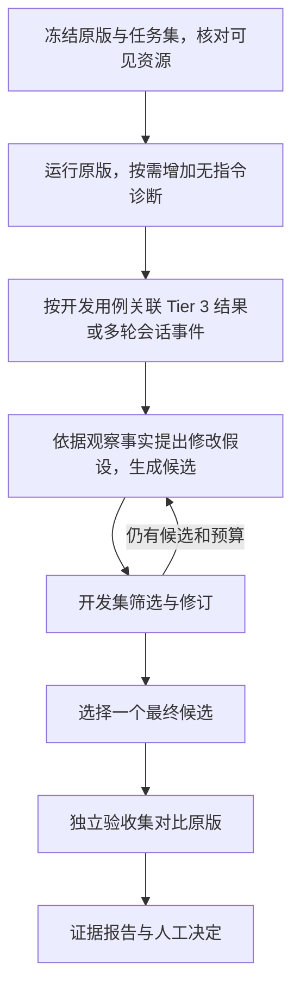

# 评测与改进方案

本文是可实施的设计草案。目标与范围见《需求》及 README。本文给出建议默认值，目标模型、费用预算和验收容差需要在首次正式实验前确定。当前完成了本地文档与源码核对，尚未运行端到端评测。

候选的修改原则见《需求》的“设计原则”。下文提出的统计非劣判据仍是验收方案草案。

## 1. 总体设计

采用“建立任务集 → 测量原版 → 生成候选 → 筛选与修订 → 独立验收 → 人工采用”的流程。

SkillEvaluator 承担静态检查、Agent 任务运行、标准评分、版本比较和证据留存。本仓库实现候选生成与管理、行为契约、交互用例驱动、验收判定和审阅报告。RSI-Harness 仅作流程设计参考，不引入其运行器、Genome 配置或会话扫描工具。



## 2. 调查结论如何进入方案

| 调查中的方法 | 本方案的使用方式 |
| --- | --- |
| 原子问答四象限 | 可选的候选排序依据，知识型条款较多时启用。删除结论依赖任务实跑 |
| 静态去重 | 找同一 skill 内重复表述以及跨 skill 的共用结构 |
| 保留操作锚点 | 对参数映射、工具入口、确认条件、产物来源建立行为契约 |
| 轨迹驱动修订 | 从开发集失败证据提出改动，附上需要保住的行为和对应测试 |
| 渐进式披露 | 将正文内容迁至配套文本时，检查引用路径及实际加载情况 |
| GEPA 等搜索框架 | 先实现有限候选循环，积累候选与评分数据后评估接入价值 |
| 成本感知优化 | 同时记录长度、运行 token、耗时、工具调用和费用来源 |

《强模型时代 Agent Skill 消减与重写落地方案》中的比例、成本和工期尚未在本项目复现，不能用于承诺收益或估算预算。原子问答中两组均答对，仅能说明该问题上未观察到收益。

## 3. 首版实验边界

| 项目 | 建议默认值 |
| --- | --- |
| 改动范围 | 按《需求》的“改动范围”生成候选快照，执行脚本使用原版副本 |
| 长度 | UTF-8 解码、换行统一为 LF 后，按 Unicode 码点计数。包含 frontmatter 和空白，候选不得超过原版 |
| 长度补充指标 | 记录字节数。可取得目标 tokenizer 时记录 token 数和 tokenizer 版本 |
| 目标运行器 | 先适配 Claude Code，模型用精确标识固定。此选择待运行前确认 |
| 候选生成模型 | 独立配置并记录精确标识，可与被测模型相同 |
| 评分模型 | 固定模型和评分提示版本。先用人工标注样例校准 |
| 环境路线 | 建议在 WSL2 中运行编排器，Docker 提供统一任务环境。可行性阶段实测安装与连接 |
| 自动采用 | 最终输出候选与审阅报告，由人工决定是否采用 |

长度按《需求》的 G-2 汇总；跨文件迁移的内容仍计入候选的总字符数。

每次实验保存原版目录内容哈希、上游提交、SkillEvaluator 提交、Agent 版本、模型及推理配置、judge 配置、容器镜像摘要、Rust 工具链、MCP 版本、任务集和评分器哈希。所有实验在本仓库的独立快照目录执行。

## 4. 数据集与行为契约

### 4.1 从任务建立覆盖

每个 skill 建一份任务清单。任务输入优先来自真实使用请求、已有 fixture 和用户期望，再用 skill 内容检查遗漏。自动生成的任务经人工审核后冻结。

| 用例类型 | 需要验证的内容 |
| --- | --- |
| 常见任务 | 核心结果正确，产物可使用 |
| 隐式请求 | 用户未点名 skill 时能正确触发 |
| 负例与边界 | 请求超出范围时行为符合要求，避免误触发 |
| 确认停点 | 首轮在要求的位置结束，确认前没有执行受限操作 |
| 完整交互 | 用户回复后继续工作，参数、工具路径和结果正确 |
| 缺依赖与失败 | 缺工具、工具失败、部分完成时如实处理 |
| 原版弱项 | 在开发集上稳定复现的原版失败，以及独立编写的同类验收任务 |

每条行为契约保存编号、来源、可观察证据、适用场景、检查方法和对应 case ID。契约检查输出“通过、失败、证据不足”。确认点、产物来源等关键项缺证时，该候选的验收保持未决。

示例为 `rust-test` 的一次完整交互。

| 契约 | 证据与检查 |
| --- | --- |
| 配置后等待确认 | 第一轮结束事件存在，确认事件之前没有项目测试执行记录 |
| 已确认配置进入 MCP | 保存实际 MCP 请求，把关键参数与确认后的配置逐项比较 |
| 报告由指定脚本生成 | 轨迹中的执行及成功状态，加上实际报告文件 |
| 测试失败后遵守修改范围 | 工作区前后差异、测试元数据和最终报告 |

关键事件优先取自运行器日志、MCP 代理日志与文件快照。Agent 在回答中声称执行过某动作，只作为辅助信息。脚本调用、MCP 的内部脚本执行可能处于不同日志层级，需在接入试验中证明各自证据可取得。

### 4.2 开发集与验收集

试点建议从 12 个开发任务和 12 个独立验收任务起步，具体数量随覆盖缺口增加。这是工程起步规模，不能预先保证能识别微小退化。

候选生成器可以读取开发集、失败轨迹和评分。验收集的输入、断言、答案与轨迹由编排器保管，生成器使用独立工作区。最终候选确定后才运行验收集。

同一个 fixture 的轻微变体按任务族分组，避免同时落入开发集和验收集。验收失败后如使用失败详情修订，该批用例转为开发用途，下轮需补充新的独立验收任务并提升数据集版本。

检查器先验证已知正确和已知错误的产物。LLM judge 用人工标注的少量样例校准，保留分歧。覆盖和检查器未校准前，报告只用于诊断。

## 5. 两类任务运行方式

### 5.1 SkillEvaluator 直接运行

单轮任务、触发任务、确认停点，以及从固定的已确认状态开始的执行任务，使用 Tier 3。内置 `checks` 覆盖脚本调用、命令成功、文件存在和输出格式等检查。领域断言通过 `default_plus_custom` 自定义 grader 补充。

任务 fixture 放在独立数据集来源中，运行前组装到被测快照的 `evals/`。运行时为 Agent 提供任务和必要输入，评分答案及 grader 保留在验证器可访问区域。接入试验检查答案是否意外进入 Agent 可读上下文。

MCP 使用 `evals/environment/mcp_servers.toml` 注入。运行镜像安装实际需要的 Python、Node.js、Rust 和系统工具。rustbot MCP 从固定提交的副本启动，保留其调用 skill 附件的目录关系。

标准模式下内置 `checks` 会把缺证项排除出均值，因此最终验收还需由本仓库逐条检查关键契约的证据完整性。

### 5.2 本仓库驱动完整多轮交互

本地版本未找到可直接配置固定用户应答序列的任务入口。新增会话驱动器，按以下状态运行同一个 Agent 会话。

```text
创建独立工作区 → 发送初始请求 → 等待 Agent 结束本轮
→ 检查停点及当前文件状态 → 发送脚本规定的用户回复
→ 恢复同一会话 → 检查产物 → 保存完整事件序列
```

用例定义每一轮的请求、可接受状态、回复规则、超时和轮数上限。运行器只有在相应状态出现后才发送确认。提前执行测试会立即形成契约失败。未出现预期状态时保留轨迹并结束该次尝试。回复条件采用可复核的规则，无法可靠识别时标为证据不足。

第一版只实现一个 Agent 适配器，封装启动、续接、取消和日志解析。具体 CLI 参数通过本机帮助及烟雾实验确定。驱动器和 Tier 3 使用相同镜像、MCP 版本及 fixture，每次尝试使用新会话和新工作区。

多轮驱动器按用例、版本和尝试编号关联会话 ID，按轮次记录用户回复、触发回复的条件、Agent 动作、工具事件和文件差异。审阅者可据事件顺序区分“Agent 提前执行”和“驱动器提前确认”；若无法还原顺序，记录证据缺口。多轮契约结果与 Tier 3 版本分数分开报告，最终判定要求两部分均满足验收条件。

阶段执行任务只能验证已经到达某阶段后的行为。完整多轮交互通过后，才能支持对该工作流端到端能力的结论。

## 6. 对照运行

对照用途见《需求》的“对照方式”。每组配对运行固定数据集、Agent、模型、judge、工具、环境和尝试次数。

启用无指令诊断时，不能直接把“不安装被测包”视为“仅不提供指令”。若卸载整包会同时移除脚本或工具依赖，需在两组中提供相同的原版运行资源，同时隔离被测指导文本。两组工具条件无法对齐时，不据此判断指令贡献。

每次运行前，编排器记录被测 Agent 实际可见的 skill、工具和额外指令来源（含 `AGENTS.md`、`CLAUDE.md`），与实验配置核对。触发测试中，原版与候选保留相同的其他 rustbot skill，只替换 `rust-test`；排除无关的全局 skill 和意外加载的指令。启用无指令诊断时，还需检查 MCP 目录或父目录是否暴露被测指导文本。资源不一致或无法核实时，保留预检记录，暂不比较结果。

原版存在失败时记录失败类型。环境或评分问题先修复并重测。原版的行为缺陷进入候选修订目标。原版未测出收益时，检查覆盖、激活与工具可用性，再由人工判断是否仍需改进或下线。

## 7. 候选生成与搜索

生成器输入原版、行为契约、条款到用例的覆盖映射，以及开发集的执行证据。每个候选产出包含正文和配套文件的完整快照、覆盖全部改动文件的 diff 和候选记录。

候选记录包含父版本哈希、长度结果和生成模型版本。每个改动分别写明观察事实、修改假设和必须保留的行为，并关联开发用例或具体轨迹事件，列出用于验证影响的用例。试点使用本次实验的开发证据，不扫描维护者的私人会话。

例如，某条开发轨迹出现两次确认，只能说明 Agent 问了两次。若前一次用于确定测试范围、后一次用于授权执行，应保留两次交互；若重复的是正文中对同一确认点的说明，可以提出合并文本的候选，用对应开发用例复查确认前未执行、确认后采用最终配置。改变交互本身须按《需求》的“自动化与人工确认”单独批准。

首轮最多生成 4 个候选，每个候选围绕一个可解释的修改假设。允许跨段合并重复说明、改写触发描述或修订失败流程。每个候选最多修订 2 次，耗尽轮数后保留最佳已验证结果。

筛选顺序如下。

1. 检查长度、文件结构、资源引用和 Tier 1 结果。
2. 跑受影响用例及全部关键契约用例，每例 1 次，仅用于快速淘汰。
3. 对保留下来的候选跑完整开发集，每例 3 次，并与同次数的原版比较。
4. 选择开发集上表现最好的一个候选进入验收。优先级依次为关键契约、任务质量、原版弱项改善，长度与运行资源用于质量相近时的比较。

组合两个通过的候选时，将组合视为新候选，重新运行完整开发集。候选在开发集上没有改善且证据不足以支持替换时，可以结束本轮并交付原版及诊断报告。

关键行为允许通过更短、更清晰的文本实现。任何关键契约的删除或语义变更，需先调整产品要求与任务集版本。

## 8. 验收判据

### 8.1 分开报告任务质量与契约

任务质量以用例预先声明的结果断言为主。可执行断言优先，语义判断由固定 judge 评分。SkillEvaluator 的五维分数作为补充诊断。关键契约逐条展示，避免被其他维度的高分抵消。

报告按《需求》的“候选验收”分列触发与执行结果。执行部分展示总体、任务类型切片、原版弱项和关键契约；两部分分别注明未评分项和基础设施错误。原版弱项在开发阶段预先定义，同类独立验收任务单列展示。

### 8.2 统计与证据边界

“没有显著差异”不足以支持非劣结论。预先设置允许的退化界限 δ，计算候选减原版的任务质量差值及其单侧 95% 置信下界。达到 `下界 ≥ -δ` 才支持相应容差下的非劣结论。

建议默认 δ 为 0，与能力不降低的目标一致。若用户接受正容差，报告必须写明数值及其业务含义。小样本经常无法达到该条件，此时交付证据不足结论。

按任务配对比较，在任务族层面进行 bootstrap，保留同一任务的全部重复尝试，避免把重复运行当成新增独立任务。对按次通过率同时报告分母。pass@k 作为补充。质量分数、关键行为与触发结果分别检查。

验收初始每例 3 次。正式运行前冻结追加采样计划、任务数量和最大尝试预算。中途查看结果后改变计划的实验标记为探索性，正式结论使用下一批独立冻结的评测。

### 8.3 最终状态

| 状态 | 条件与后续动作 |
| --- | --- |
| 建议采用 | 长度合格、总体任务运行成本未增加、关键契约全部通过且证据完整、质量达到预设非劣条件、关键切片无预设禁止的回归。交人工审阅 |
| 建议退回 | 长度超限、总体任务运行成本增加、关键契约失败，或出现达到预设退化判据的质量损失。附对比证据 |
| 证据不足 | 缺证、基础设施失败、覆盖不足或区间无法判定。保留候选与补测清单 |

成本验收依据见《需求》的“任务运行成本”。报告分列实付费用与可复核的估算费用，并记录耗时和工具步数。

## 9. SkillEvaluator 接入与版本管理

本次核对的本地包版本为 `0.9.0`，提交为 `64b237f0`。下表来自该提交的文档与源码，运行兼容性待实测。

| 能力 | 接入方式 | 需要补充的工作 |
| --- | --- | --- |
| 静态与加载检查 | Tier 1 | 将已有问题与候选新增问题关联到审阅报告 |
| 相似内容检测 | Tier 2，可选 | 给候选生成器提供位置和原文 |
| 单轮任务与激活 | Tier 3 | fixture、任务、领域断言与独立验证集 |
| 特定行为评分 | 内置 checks、BYOG | 缺证处理、MCP 事件及关键契约总判定 |
| 版本比较 | `--compare-to` | 编排器使用明确运行 ID，检查比较是否真正产生 |
| 无 skill 基线复用 | `--reuse-baseline` | 只复用符合上游兼容检查的完整新鲜基线 |
| MCP | `evals/environment/mcp_servers.toml` | 环境构建、固定运行依赖和调用证据验证 |
| 多轮用户应答 | 本仓库会话驱动器 | 首版适配 Claude Code，并执行真实续接试验 |

少量用例、少次数的筛选运行单独保留。正式版本比较需要相同数据集、模型、judge、环境和尝试策略，不能直接拿筛选结果作为正式原版基线。开发集和验收集分别生成各自的基线与运行 ID。

共同环境依赖放入统一镜像或 fixture。上游 `pre_agent_setup` 只允许用于有 skill 的单组运行，成对对照会拒绝该设置。

## 10. 本仓库的实现结构

以下为待实现目录。

```text
src/skill_harness/           编排、候选生成、运行适配、契约和报告
configs/                    实验配置、模型标识、预算、版本锁定
datasets/<skill>/           契约、开发集、验收集、fixture、评分器
snapshots/<skill>/<hash>/   固定的原版与候选内容
runs/<experiment-id>/      运行清单、任务状态、原始轨迹与判定
exports/<experiment-id>/   最终候选、diff 与人工审阅报告
```

最小编排状态为 `prepared → baselined → searching → selected → evaluated → reviewed`。`reviewed` 记录人工选择及理由。每一步完成后原子写入状态及输入哈希，重启时校验已有产物再恢复。

每次尝试有独立目录和状态。基础设施失败最多自动重试一次，保留两次记录。Agent 执行失败和契约失败作为测量结果，不自动重跑至成功。并发任务使用独立工作区，取消后保存日志并关闭对应进程或容器。

预算同时限制候选数、Agent 尝试数、最大并发、单次超时和 judge 调用。费用估算只辅助准入。到达预算后停止启动新任务，保存已运行结果及缺口。

最小报告包含版本与环境、长度对比、逐例结果、关键契约、统计区间、原版弱项变化、资源消耗、失败轨迹链接、diff 和最终状态。模型不可用、缺凭据、基础设施失败分别记录，便于恢复运行。

## 11. 分阶段落地与完成条件

| 阶段 | 工作 | 完成条件 |
| --- | --- | --- |
| P0 接入验证 | 固定模型与预算，检查 WSL2、Docker、Agent、SkillEvaluator，用 `rust-test` 验证 MCP 调用、会话续接和报告生成 | 可取得真实输出、轨迹和产物。能证明确认前停止、确认后续接。启用无指令诊断时，能验证两组工具和脚本一致 |
| P1 数据与基线 | 完成 `rust-test` 的行为契约、开发集、验收集与评分校准 | 原版基线可重复执行，关键证据均可定位；如开展无指令诊断，另存配对结果 |
| P2 自动改进 | 实现候选循环、长度检查、运行恢复与开发集筛选 | 自动产出可追溯候选、筛选结果和失败理由，达到预算能正确停止 |
| P3 独立验收 | 冻结最终候选并运行独立任务集，输出审阅包 | `rust-test` 的审阅包足以支持人工决定采用、退回或补测；无合格候选时说明原因 |
| P4 扩展 | 按工具与交互复杂度接入剩余 skill | 每新增一个 skill 都有独立契约、fixture 和基线。共用文本改动逐个验收 |

`rust-panic-scan` 当前依赖 MCP 与 nightly，安排在相应环境可用后接入。

P0 出现接入失败时，记录具体能力缺口及所需适配。P1 至 P3 的端到端结论以 P0 验证通过为前提。工期、费用和预期改善幅度待试点测量后估算。

首次运行仍需确定目标模型的精确标识与凭据来源、允许的总尝试预算和费用上限。其余默认值可按本文形成实验配置，实际启动前在审阅清单中展示。

## 12. 依据

RSI-Harness 参考版本 `7bf09774`：[可见资源与隔离边界](https://github.com/CosmosMind-ai/RSI-Harness/blob/7bf09774bbe205956ec5a46e5f934602224cc437/docs/genome/harness-rsi.md)、[会话续接与事件流](https://github.com/CosmosMind-ai/RSI-Harness/blob/7bf09774bbe205956ec5a46e5f934602224cc437/docs/rsih_in_cli.zh-CN.md)和[从证据提出修改](https://github.com/CosmosMind-ai/RSI-Harness/blob/7bf09774bbe205956ec5a46e5f934602224cc437/config/genomes/harness-rsi/skills/genome-authoring/pattern-to-component.md)。

- [Agent Skill 精简与重写研究综述](../../research/skill-improvement-research.md)
- [SkillEvaluator 运行与版本比较](../../SkillEvaluator/docs/tier3-run-reference.mdx)
- [数据集、内置检查及 MCP 环境](../../SkillEvaluator/docs/eval-datasets.mdx)
- [自定义评分器](../../SkillEvaluator/docs/custom-graders.mdx)
- [Agent 与沙箱](../../SkillEvaluator/docs/agents-and-sandboxes.mdx)
- [激活验证](../../SkillEvaluator/docs/tier3-experiments.mdx)
- [rust-test](../../rustbot/engineer-pack/rust-test/SKILL.md)
- [rust-panic-scan](../../rustbot/expert-pack/rust-panic-scan/SKILL.md)
