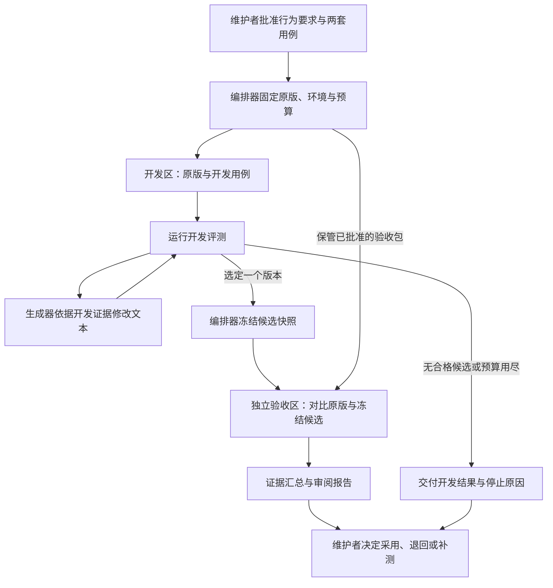

# rust-test 试点结构设计

状态：设计草案，尚未实现或实跑。试点要回答的是：维护者能否从一次对照实验中判断，候选是否保留了 `rust-test` 的能力，并满足长度和成本约束。验收口径以[需求](01-需求.md)为准；工具接入选项见[评测与改进方案](02-评测与改进方案.md)。

## 实现沙箱

试点拟从第一轮起使用 Docker。新建专用 WSL 2 发行版承载 Docker 引擎，保留现有 Ubuntu，不修复或复用其 Docker 服务。维护者控制引擎；试点代码的编写、依赖安装、构建和任务执行在专用容器内完成。候选生成器和被测 Agent 不获得引擎管理权限。

### 最小落地顺序

1. **准备宿主。** 单独批准创建环境后，再注册专用发行版、安装 Docker 引擎并确认客户端连接的是该发行版的引擎。为专用发行版关闭 Windows 盘自动挂载和 Windows 互操作，不改现有 Ubuntu 或全局 WSL 配置。先确认专用引擎能启动空白测试容器，再导入项目材料。
2. **划分存储。** 只复制本次所需原版材料到专用存储，作为只读输入；实现代码和开发产物写入开发卷，验收包与验收结果另存。冻结候选后，按内容哈希交接只读快照，不将整个开发卷送入验收区。每次任务使用新的可写工作区；被测 Agent 只见该次任务输入，不挂载评分答案。
3. **先验证边界，再装试点依赖。** 用无凭据、无项目数据的测试材料，按[启动前验证清单](rust-test-试点验证清单.md)检查实际挂载、可写位置和开发侧对验收标记的可见性。容器不使用特权模式，不挂载 Windows 项目根目录、宿主用户目录或 Docker 管理套接字。检查未通过即停止，不回退到宿主机运行。
4. **固定镜像并做接入验证。** 边界通过后再构建试点镜像，记录镜像摘要；原版与候选在相同镜像和工具条件下运行。需要发起容器的 SkillEvaluator 调度操作由可信控制端承担，不向任务容器转交 Docker 接口。首次接入先验证一条触发用例和一次多轮确认，核对 SkillEvaluator 实际创建的任务容器仍满足同一隔离清单。需要模型服务时单独批准凭据与预算，只导出选定的产物和证据。

## 总体结构

建议用一个编排器管理实验，开发和验收使用隔离的工作区。两区复用同一套执行工具，但不共享题目、会话、评分记录或可写目录。以下是职责划分，不要求部署多个服务。

## 组件与交付物

| 组件或角色 | 输入与职责 | 交付物与边界 |
| --- | --- | --- |
| 实验编排器 | 从只读上游复制原版；固定可见的 skill、工具、指令来源、模型和费用口径；调度预检、开发及验收 | 实验清单、数据集版本、原版及候选快照标识。环境不可比则停止比较，不写回上游 |
| 用例生成与审阅 | 大模型根据同一组能力要求，在独立上下文中分别生成开发包和验收包；维护者审阅、修订并批准任务、回复条件和判断标准 | 两套冻结的用例。编排器将答案留给评分端，模拟用户回复按轮发送，被测 Agent 不预读整份脚本 |
| 候选生成器 | 读取原版文本、已批准的行为要求和开发证据；每个候选验证一个修改目的 | 文本差异、修改假设、应保留的行为及对应开发用例。只能写候选副本中的正文及配套文本；脚本变更不进入评测，必要交互变更先交维护者批准 |
| SkillEvaluator | Tier 1 检查快照；Tier 2 可选，用于定位重复内容；Tier 3 在当前区运行触发及单轮执行用例 | 运行标识、逐例评分和触发证据。用兼容的原版与候选运行做版本比较；回答正确本身不是触发证据 |
| 多轮会话驱动器 | 根据批准的条件发送回复；同一次尝试续接同一会话，换版本或尝试则新开会话和工作区 | 对话轮次、回复条件、实际工具调用、执行结果及报告文件的关联记录；不自行补答，不用单轮成绩代替多轮证据 |
| 证据汇总与维护者 | 按用例、版本、尝试编号关联两条执行路径的记录，并核对字符数和直接运行费用 | 分列触发与执行结果，给出采用建议、退回理由或证据缺口。最终由维护者决定，不自动合并 |

## 实验的三个交接点

1. **从原版到候选。** 开发区先运行原版。若正常完成任务却多问了一次，生成器要指明对应轮次、两次问询的作用和拟修改的文本，不能仅凭次数删去确认。编排器核对可改文件清单、脚本与原版是否一致、总字符数和资源引用后，才安排候选运行。开发失败可用于修订；组合版本视为新候选。
2. **从开发到验收。** 编排器记录最终候选的内容哈希，验收区只读载入该快照和原版，使用相同用例和条件独立运行。候选生成器的工作区不挂载验收包、评分器答案和验收结果，也不复用验收会话。无指令组只用于开发诊断，不代替原版。预算耗尽且没有合格候选时不启用验收集。
3. **从验收到人工决定。** 每个关键行为的判定都要能回到本次尝试的事件或产物。报告分别列示总体及分类成本、实付或估算依据和缺项。证据不足时不推荐采用。维护者若用验收反馈继续修订，本批验收用例转入开发用途；新候选须用另一套经批准的独立用例验收。

## 提前执行的归因

以“修改配置后才开始测试”为例。驱动器记录确认条件何时满足、何时发送回复；执行侧记录首次项目测试调用、实际 package 参数和报告来源。工具帮助读取不算执行项目测试。审阅时按同一次尝试对齐事件：

- 驱动器尚未确认，Agent 已开始项目测试：判为关键行为失败。若来自开发集，可关联失败事件修订候选。
- 驱动器在条件尚未满足时提前确认：判为本次评测无效，修正驱动后在相同条件下重测，不能据此责令修改 skill。
- 调用或确认记录缺失，无法分辨两者：标为证据不足。不能用最终报告正确推断执行顺序正确。

## 设计验证

[试点验证清单](rust-test-试点验证清单.md)用于检验上述设计，而非给候选打分。先验证确认后的实际执行，再用已知原因的记录检查错误归因，最后检查验收失败能否阻止推荐且不向生成器泄露用例。通过清单才说明这些机制在所测场景可用；没有合格候选也可以完成试点。

进入实跑前仍需确定运行器、目标模型和预算，并实测会话续接、MCP 调用记录、报告来源、资源隔离和费用证据是否可取得。RSI-Harness 仅作设计参考，不是运行依赖。
